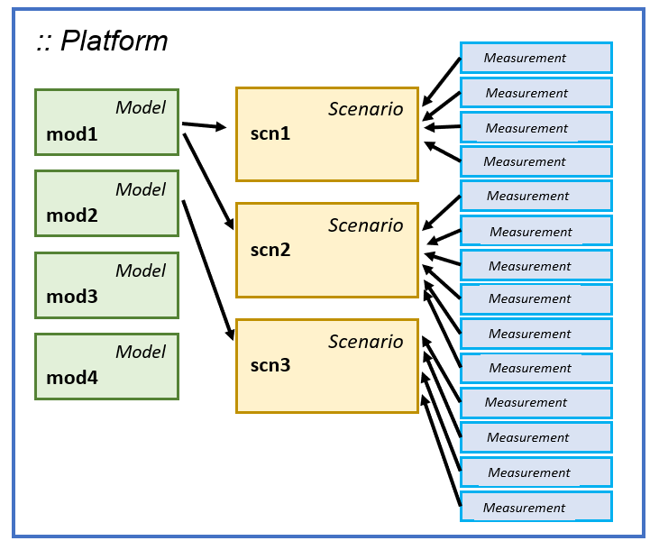

# Introduction

HetaSimulator was designed as a modeling, simulations and parameters estimation environment for Quantitative Systems Pharmacology (QSP) and Systems Biology (SB) projects.
A user is not intended to be experienced Julia programmer but rather a researcher having biological, biophisical and bioinformatical background.
We have avoided complicated user interfaces and tried to keep the available computational methods simple for the basic modeling workflow.

The approach implies the "modeling platform" term which means all the components of a model: models structure, variables, parameters, scenarios and experimental dataset. From the practical point of view "modeling platform" is the same as project files.
The representation of modeling platform in HetaSimulator package is an object of the [`Platform`](@ref) type.
This object stores `HetaODESystem`s, `Scenario`s and `Measurement`s.

## Migrating older code (HetaSimulator < 0.9.x)

The `Model`, `load_jlplatform`, and `load_jlmodel` APIs and the
`save_scope` option have been removed. Result tables no longer contain an
event-name `scope` column, and result lookups and measurements no longer accept
scopes. `result(t, :variable)` selects the first saved row at that time.
To access another row at a discontinuity, use its index, for example
`result[:variable, findlast(==(t), times(result))]` for the last saved row.

Results now store ordinary numeric vectors in a `DiffEqArray`, with observable
names attached to the time series. Use `result[:A, i]` instead of
`result[i][:A]` or `result[i].A`, and `result(t, :A)` instead of `result(t)[:A]`.
`result[i]`, `result(t)`, and single-time ensemble statistics return numeric
vectors in the order given by `observables(result)`. Statistical time series
retain names: for example, `timestep_mean(mcresult, :)[:A, :]` selects the
mean trajectory of `A`. Plots and DataFrame exports retain named observables.

Known limitation with HetaImporter 0.3.1: separate continuous events that cross
at exactly the same time can lose the second event in the native solver.
The multi-event regression test records this upstream behavior explicitly.

## Architecture

`load_platform` imports native systems through HetaImporter's
`import_heta_all`. `Scenario` builds a native `ODEProblem`; parameter remaking,
initialization, events, and observable evaluation are handled by HetaImporter.

`HetaODESystem` type represents one model (concrete namespace) imported from [Heta-compiler](https://hetalang.github.io/#/heta-compiler/). It stores information about ODE system, initial values, events as well as default model-level parameters values. The HetaSimulator approach imply multi-model usage so simulations and parameters estimation can be done for several models simultaneously without specific preparations.

[`Scenario`](@ref) type stores additional conditions for simulating the model. For example, the same model can be run with or without some events, or differ by some specific parameters values like doses and others, or have some specific output variables (observables). Each `Scenario` is associated with a specific `HetaODESystem`. Each model may be used in different scenarios.

Additionally `Scenario` instance is a container for the `Measurement` objects which describe experimental datasets. `Measurement`s can be used for estimation of model parameters or some specific tasks like identifiability analysis and visualization. 

There is no need to create more than one `Platform` object because it can store any number of `HetaODESystem`s and `Scenario`s. The advisable workflow is:
1. Create one `Platform` using [`load_platform`](@ref) method
2. Update it by `Scenario`s and `Measurement`s using formatted CSV tables or directly in code
3. Apply `sim`, `mc`, `fit` and other methods to simulate the model, estimate the parameters, etc.

There are basic methods that can be applied to a `Platform` object, for example `sim`, `mc` and `fit`.
These methods can be applied to a particular `Scenario` or to the whole `Platform` (all scenarios in platform).
The last approach is preferable.

## HetaSimulator vs heta-compiler

Both [heta-compiler](https://hetalang.github.io/#/heta-compiler/) and HetaSimulator.jl are part of the __Heta project__ initiative.
They use the same standards of model notation and can be used in the same projects.
Furthermore currently `heta-compiler` JS code is used internally in HetaSimulator.

When a user installs HetaSimulator in Julia the most appropriate version of __heta compiler__ is installed as well.
